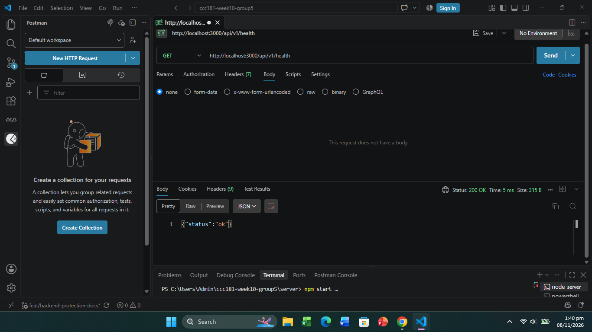
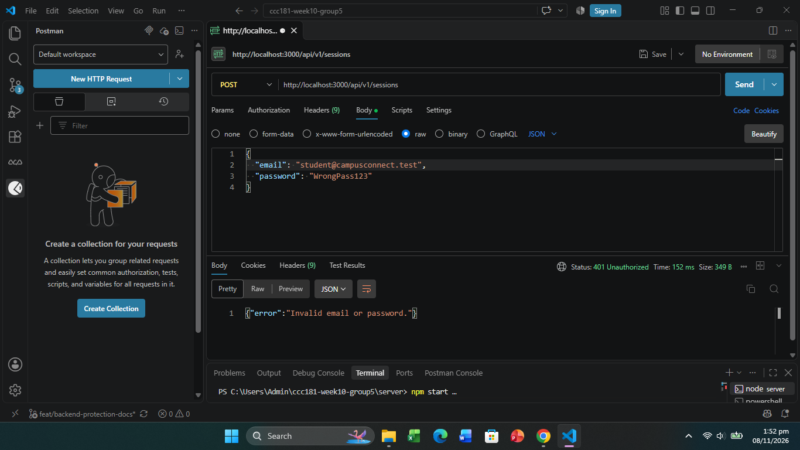
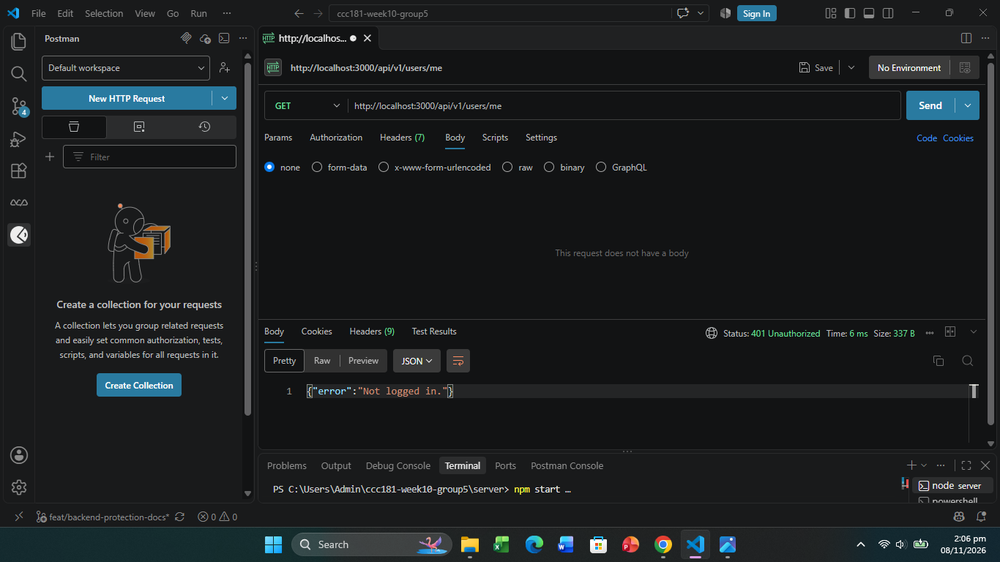
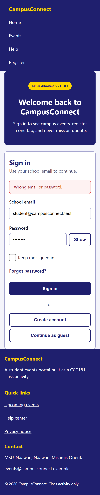
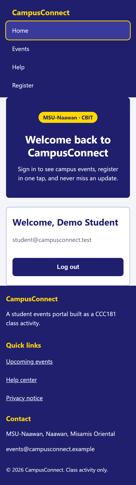

# CCC181 Week 10: CampusConnect Mobile-First Login Page

React + TypeScript starter for the Week 10 group activity. The page is already
built. Your group's job is the **mobile-first CSS** and the **GitHub teamwork**.

## Run it

```bash
npm install
npm run dev          # open the local URL it prints
npm run dev:phone    # same, but your phone (same Wi-Fi) can open the Network URL
npm run build        # must finish with no errors before you submit
```

## Rules

- Edit only the CSS files in `src/styles/` (one member = one file). Do not edit `reset.css`.
- Plain CSS only. No Tailwind, Bootstrap, Material UI, styled-components, or any UI library.
- Phone styles first (no media query), then `min-width` queries only. Never `max-width`.
- Do not edit the `.tsx` files or rename classes. If you must, tell the group first.

## Group information (fill in)

| Item | Your answer |
| --- | --- |
| Group number | 5 |
| Section | A |
| Repository URL | https://github.com/jonasdaligdig-svg/ccc181-week10-group5.git |

## Members (each member fills in their own row in their own commit)

| Member | Name | GitHub username | CSS file | What I did |
| --- | --- | --- | --- | --- |
| 1 | Shaun Armand E. Porras | `PorrasShaun` | `src/styles/base.css` | Built viewport meta tag and mobile-first page & brand panel layout (`feature/base-shaun`) |
| 2 | Jonas M. Daligdig | `jonasdaligdig-svg` | `src/styles/nav.css` | Built mobile-first stacked Flexbox navbar and 1-column Grid footer with 48px touch targets, then added 768px and 1024px responsive layouts (`feature/nav-daligdig`) |
| 3 | Ruby Jean Gabilan| `gabilanrubyjean-pixel`| `src/styles/form.css` | Built a mobile-first login card with stacked Flexbox form fields, 48px inputs and buttons, focus-visible styles, and responsive form options and button layouts at 768px and 1024px (`feature/form-ruby`)|

## Experiment 0: the page without the viewport tag

What did the page look like in DevTools phone mode **before** adding the viewport meta tag?
What changed **after** adding it?

Before adding <meta name="viewport" content="width=device-width, initial-scale=1" />, mobile DevTools simulated a wide ~980px virtual desktop screen and zoomed all the way out, making the text and inputs tiny and hard to tap. After adding the viewport meta tag, the browser matched the actual device width 360px, allowing our mobile-first CSS rules, 16px readable text, and 48px touch targets to scale at true 1:1 size.

## DevTools test results

| Width | What must be true | Pass? |
| --- | --- | --- |
| 360 px | 1 column. Nav links stacked and 48px tall. Options and buttons stacked. Footer in 1 column. No sideways scrollbar. | Yes(Pass) |
| 768 px | Nav in one row (brand left, links right). Checkbox and link in one row. Two buttons side by side. | Yes(Pass) |
| 1024 px | Brand panel and login card side by side. Footer in 3 columns. Heading is larger. | Yes(Pass) |
| 1280 px | Content centered and stops at 1200px. | Yes(Pass) |

### Breakpoints I observed

Using **Show media queries** and dragging slowly from 360 px to 1280 px, the layout changed at these exact widths:

The layout changed at exactly 768px, 1024px, and 1280px matching our min-width media queries. No width in between looked broken, overflowed, or caused a horizontal scrollbar.

Screenshots are in `screenshots/` as `360.png`, `768.png`, `1024.png`, `1280.png`.

## What our group learned (leader writes this last)

> Our group learned how to build a responsive interface starting from a 360px mobile base layout and progressively enhancing it with min-width media queries at 768px, 1024px, and 1280px, while enforcing 48px touch targets and 16px font sizes for mobile usability. We also learned how dividing CSS into modular files (base.css, nav.css, form.css) across separate Git feature branches and cross-reviewing Pull Requests prevents merge conflicts and keeps teamwork organized.

---

## Part 2: Login with the API

### How to run

Terminal 1 (backend):

```bash
cd server
npm install
copy .env.example .env
npm start
```

Terminal 2 (front end, in the project root):

```bash
npm install
copy .env.example .env
npm run dev
```

Open http://localhost:5173 and log in with the demo account:
`student@campusconnect.test` / `Campus26`.
Both `.env.example` files hold fake values. The real `.env` files are not committed.

### API summary

| Method | Endpoint | Description |
|---|---|---|
| GET | `/api/v1/health` | Checks that the API is running |
| POST | `/api/v1/sessions` | User login (returns JWT token) |
| GET | `/api/v1/users/me` | Returns the logged-in user (needs the token) |

*For full request/response details, see [docs/API-SPEC.md](docs/API-SPEC.md).*

### Who did what (Part 2)

| Name | GitHub Username | What I did in Part 2 |
|---|---|---|
| Shaun Armand E. Porras | @PorrasShaun | Back end: set up Express server in server/, added GET /api/v1/health and POST /api/v1/sessions with bcrypt password check and JWT signing. |
| Jonas M. Daligdig | @jonasdaligdig-svg | Configured local environment and captured the required backend protection and 360px UI validation screenshots. |
| Ruby Jean Gabilan | @gabilanrubyjean-pixel | Front end: added .env and src/api/auth.ts, made the login form call the API with Loading, Success and Error states, added the Welcome screen with refresh and Log out, and styled it in auth.css. |

### Part 2 Screenshots

**1. API Health Check**


**2. Valid Login (200 OK)**


**3. Invalid Login (401 Unauthorized)**


**4. Protected Route without Token (401 Unauthorized)**


**5. UI Login Fail (360px width)**


**6. UI Login Success (360px width)**

